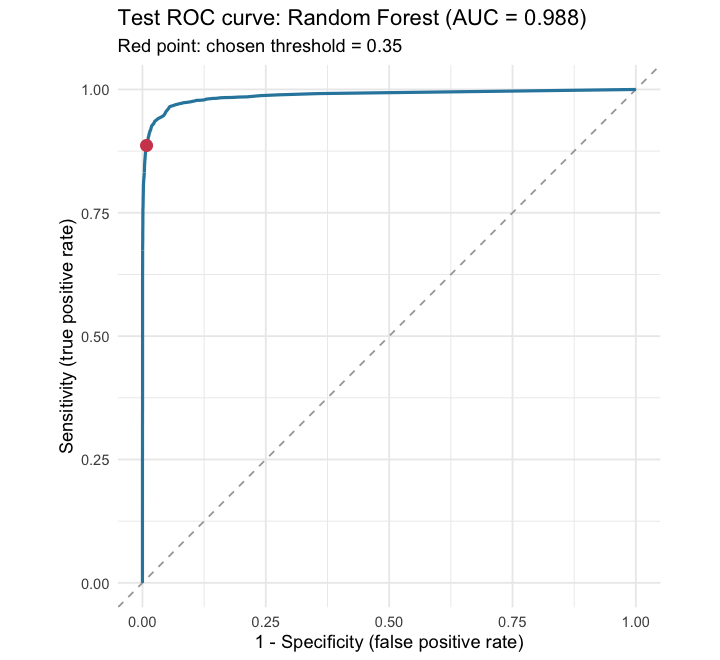
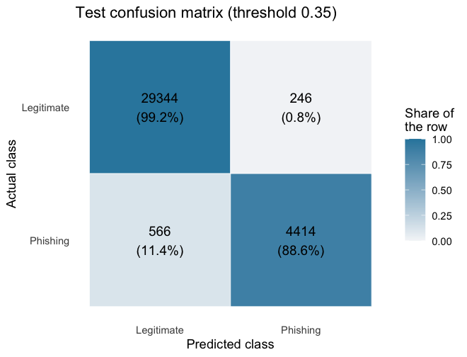
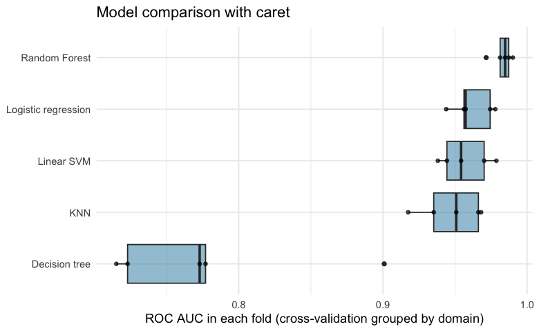

# Phishing URL detection in R

A classifier that decides whether a URL is **phishing** or **legitimate** using only how it is written (length, symbols, entropy, HTTPS, etc.), without loading the page. Built in R with `caret` and evaluated with a **domain-grouped split**, so the metrics reflect performance on sites the model has never seen.

## Results

The best model was **Random Forest**. On 34,570 test URLs from domains that do not appear in training:

| Metric | Value |
| --- | --- |
| AUC | 0.988 |
| F1 | 0.916 |
| Sensitivity (phishing detected) | 0.886 |
| Precision | 0.947 |
| Specificity | 0.992 |
| Accuracy | 0.977 |

<p>
  
  
</p>

## Why split by domain

Many URLs share a site (thousands of phishing pages can be hosted on a single domain). With a random row-level split, the same site lands on both sides and the model can "recognize" the site instead of learning to detect phishing, which inflates the metrics (data leakage).

So:

- Train and test (70/30) are split **by domain**: no domain appears in both sets.
- Cross-validation (5 folds, `groupKFold`) is also grouped by domain.
- All preprocessing and feature selection are fitted **on the training set only**.
- The decision threshold (0.35) is chosen by maximizing F1 on cross-validation predictions, without touching the test set.

For reference, published studies on this same dataset report an F1 between 0.92 and 0.94 with random splits, and around 0.87 when splitting by domain.

## Pipeline

1. **Cleaning:** duplicate URLs and URLs with contradictory labels are removed (115,231 remain).
2. **Feature engineering:** suspicious words (login, verify, bank…), presence of `@` and of query parameters, and the share of the URL taken by the path and by the domain.
3. **Preprocessing:** `log(1 + x)` for counts and lengths, near-zero-variance filter, Pearson correlation filter and z-score standardization.
4. **Feature selection:** Spearman correlation and Random Forest Gini importance, plus VIF to remove multicollinearity. 14 of 27 candidates are kept.
5. **Additional analysis:** descriptive statistics, contingency tables (χ², Cramér's V, odds ratio), Lorenz curve of URLs per domain, logistic regression to interpret effects, and PCA.
6. **Models:** logistic regression, KNN, linear SVM, decision tree and Random Forest, trained with `caret` under the same conditions and compared by AUC.



## How to run

1. Open `phishing-url-detection.Rproj` in RStudio.
2. Run `main.R` (**Source**). Missing libraries (caret, ggplot2, pROC, randomForest, kernlab, rpart) are installed automatically. It takes a few minutes.

Figures are saved to `figures/` and tables and values to `results/` as CSV. The seed is fixed (2026), so results are reproducible.

## Project structure

```
├── main.R                    entry point: runs the whole pipeline
├── scripts/                  functions, one stage per file
│   ├── 00_utils.R               metrics and optimal threshold
│   ├── 01_load.R                reading, validation and cleaning
│   ├── 02_descriptive.R         descriptive stats, boxplots, scatter plots, Pearson, Lorenz
│   ├── 03_preprocessing.R       domain split, feature engineering, filters
│   ├── 04_selection.R           Spearman, contingency, Gini, VIF, logistic regression, PCA
│   ├── 05_modeling.R            model comparison with caret
│   ├── 06_evaluation.R          ROC, confusion matrix, probability scatter
│   └── 07_export.R              export of results to CSV
├── data/                     put the URL-Phish CSV here (not included)
├── figures/                  plots (PDF, plus PNG for this README)
└── results/                  tables and values (CSV)
```

Every function documents its precondition, postcondition and invariant, and critical conditions (for example, that no domain is in both train and test) are checked at runtime with `stopifnot()`.

## Data

**URL-Phish** (Linh and Hung, 2025, *Data in Brief*), available on Mendeley Data (doi: [10.17632/65z9twcx3r](https://doi.org/10.17632/65z9twcx3r)). Legitimate and phishing URLs (from PhishTank) collected between November 2024 and September 2025, with 22 precomputed lexical features.

The CSV is not included in this repository. Download it from Mendeley Data and copy it into `data/` before running `main.R`.

> **Warning:** the CSV contains real phishing URLs. The code only treats them as text; do not open them in a browser.

## Limitations

- Legitimate and phishing URLs come from different sources, so part of what the model learns may be specific to each source (for example, HTTPS usage).
- Test metrics come from a single 70/30 split.
- Only the URL is analyzed, not the page content.
